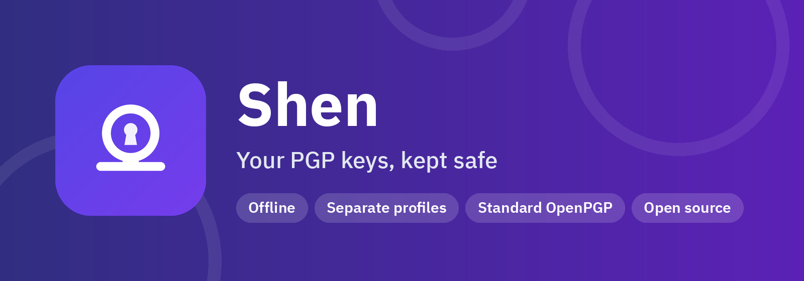

[العربية](README.md) | **English**

<p align="center">
  
</p>

<p align="center">
  <a href="https://github.com/AdamG00D/Shen/actions/workflows/ci.yml"></a>
  <a href="https://github.com/AdamG00D/Shen/releases/latest"></a>
  <a href="LICENSE"></a>
  
  
</p>

# Shen — شِن

An **OpenPGP** key manager for Android in the spirit of Kleopatra: create your keys, add other people's keys, and
encrypt, decrypt, sign and verify text and files. **Fully offline** — the app has no INTERNET permission at all, so it
cannot send anything anywhere.

The name comes from the ancient Egyptian **shen ring** — a loop of rope tied at the bottom, the symbol of protection,
which stretched into the cartouche that protected a king's name.

## Features

- **Separate profiles** (personal, work...) — each with its own keys and contacts, and optionally its **own password**.
- **Contacts**: someone's public key lives in the profile you added it to (the default), or can be **shown in all
  profiles**.
- **Key verification**: scan a **QR code** from the other person's phone, compare fingerprints yourself, or **certify**
  their key with yours.
- **Encrypt / decrypt** text and files of any size, to one or more people or with a password. Decrypted files are only
  ever written where you choose.
- **Sign / verify**: cleartext signatures or detached `.sig` files, with a plain green / yellow / red result.
- **Key management**: Ed25519 (default), RSA-4096 or the new v6 format; change expiry or passphrase, add identities,
  revoke — a **revocation certificate** is created with every key.
- **Encrypted backups** (everything or one profile) in an open OpenPGP format you can decrypt without Shen.
- **Share → Shen** and **Open with** for `.asc` / `.pgp` / `.sig` files.
- **Arabic and English**, light and dark themes, accent colours.

## Security at a glance

- All data is encrypted with AES-256-GCM. The master key is protected by your master password (Argon2id) **and** an
  Android Keystore key (StrongBox when available) — copying the app's files off the phone is useless.
- Secret keys stay encrypted with their own passphrases inside the vault.
- Fingerprint unlock is optional and **cryptographically bound**: the fingerprint decrypts the vault key itself.
- Auto-lock, screenshots blocked, a clipboard that clears itself, Android backups disabled, and the master password is
  asked again for anything dangerous (exporting a secret key, deleting).
- The OpenPGP engine is [PGPainless](https://pgpainless.org) on Bouncy Castle (audited by Cure53); tests check
  interoperability with GnuPG in both directions.

Details and known limitations: [SECURITY.md](SECURITY.md). Storage layout: [docs/ARCHITECTURE.md](docs/ARCHITECTURE.md).

## Download

From the [releases page](https://github.com/AdamG00D/Shen/releases/latest):

| File | For |
|---|---|
| `Shen-<ver>-arm64-v8a.apk` | **Most phones** — pick this if unsure |
| `Shen-<ver>-armeabi-v7a.apk` | Older or low-end phones |
| `Shen-<ver>-x86_64.apk` | Emulators and Chromebooks |
| `Shen-<ver>-universal.apk` | Any device (larger download) |

Android 8.0 or newer.

### Verify the download

Every release has `SHA256SUMS.txt` and its signature `SHA256SUMS.txt.asc`, made with the release key
([docs/shen-release-key.asc](docs/shen-release-key.asc)), fingerprint:

```
B2D4 53B8 5430 D721 C173   3C1F B0E8 ADA6 3BD7 84BC
```

```bash
gpg --import shen-release-key.asc
gpg --verify SHA256SUMS.txt.asc SHA256SUMS.txt
sha256sum -c SHA256SUMS.txt --ignore-missing
```

## Building

```bash
flutter pub get
flutter analyze && flutter test
(cd android && ./gradlew :app:testDebugUnitTest)   # crypto core + GnuPG interop
flutter build apk --release                          # without the signing key it is signed with the debug key
```

Needs Flutter (stable), JDK 17+ and the Android SDK. Official releases are built with `scripts/build_release.sh`.

## Contributing

Welcome! Read [CONTRIBUTING.md](CONTRIBUTING.md). Security issues **don't go in public issues** — see
[SECURITY.md](SECURITY.md). What's next is in [ROADMAP.md](ROADMAP.md): an OpenPGP provider for email apps and YubiKey
support.

## License

[GPL-3.0-or-later](LICENSE). The IBM Plex Sans Arabic font is under the [SIL OFL 1.1](assets/fonts/OFL.txt).
